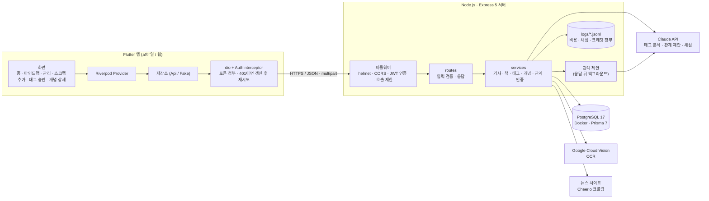
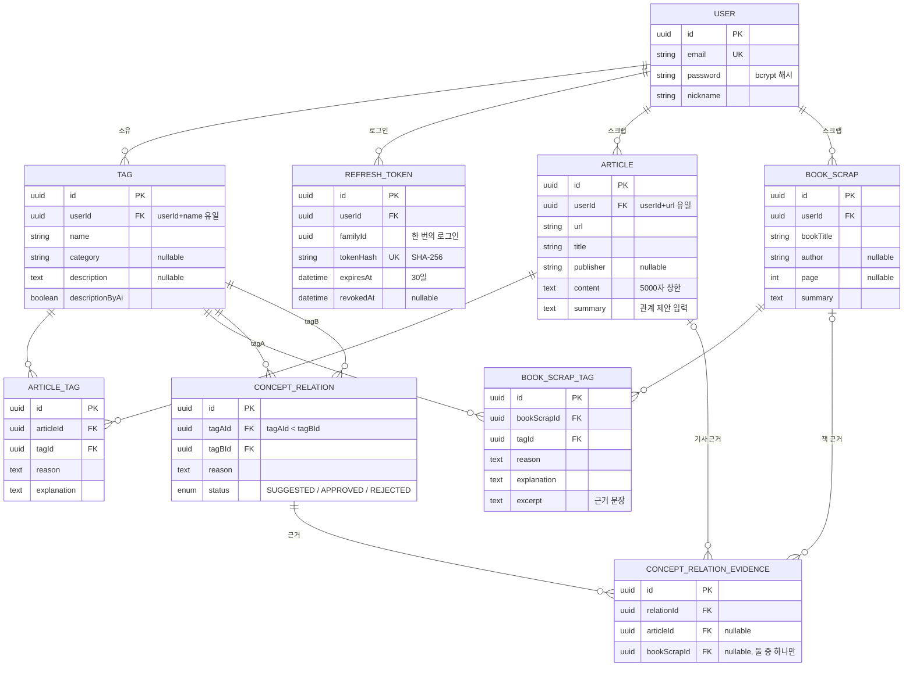
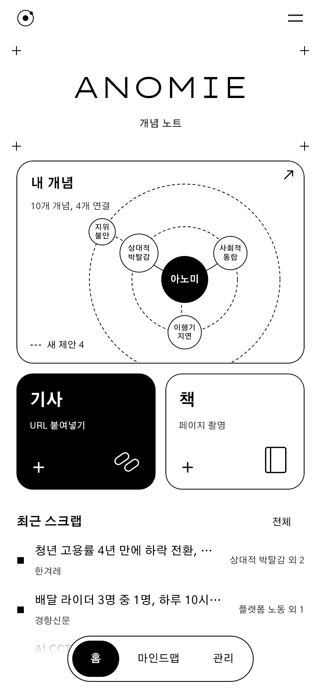
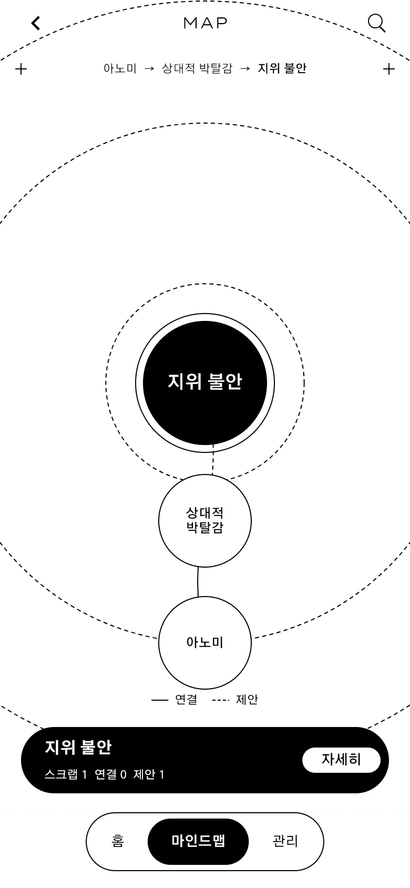
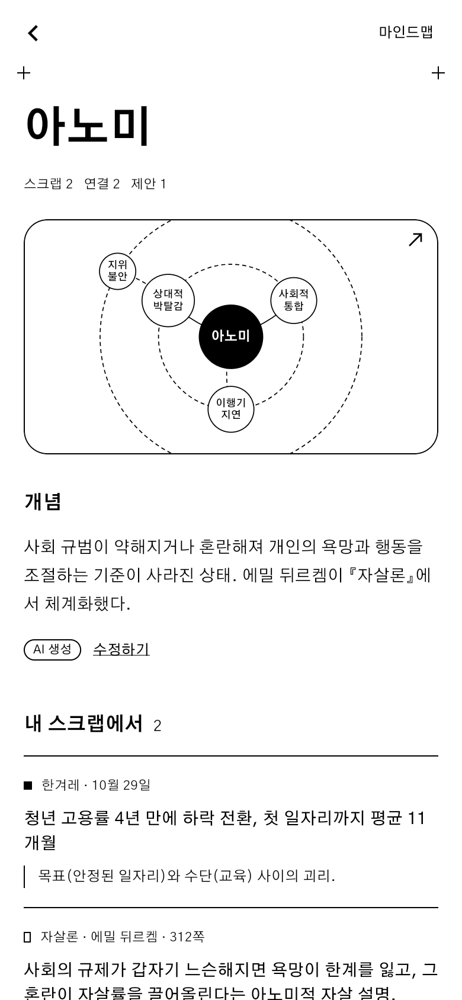
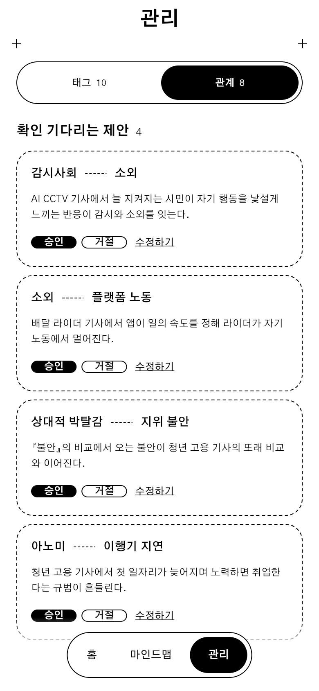
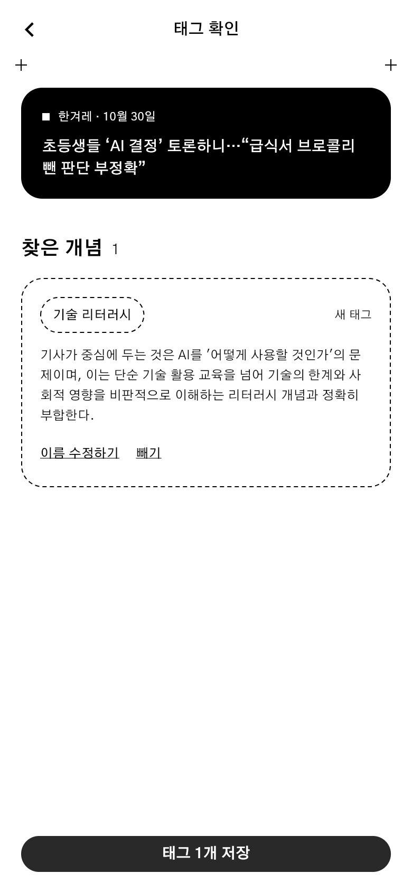

# Anomie — 이론과 현실을 개념으로 잇는 개념 노트

## 1. 프로젝트 개요

- 뉴스 기사(URL)와 책 구절(사진 → OCR)을 스크랩하면 Claude가 **개념 태그**를 제안하는 모바일 앱입니다.
- 사용자가 승인한 개념들 사이의 관계도 Claude가 **사용자의 스크랩을 근거로** 제안하고, 승인된 관계가 쌓여 하나의 **지식 그래프(마인드맵)** 가 됩니다.
- 핵심 원칙은 **"Claude API가 제안 → 사용자가 승인"** 이고, 책(이론)과 뉴스(현실)가 같은 개념으로 이어지는 것이 이 앱의 차별점입니다.

> 진행 상황 (2026-10-30): 서버 API는 기사·책·개념·관계·인증 모두 구현됨. Flutter 앱은 인증·개념·관계가 서버와 연결됐고, 스크랩(기사 → 책) 연동을 진행 중입니다. 상세 기획과 결정 기록은 [`doc/plan.md`](doc/plan.md).

---

## 2. 시스템 상세 — 어떻게 동작하는가

### 2-1. 스크랩 → 태그 승인

| 단계 | 기사 | 책 |
|---|---|---|
| 입력 | 기사 URL (클립보드 감지) | 책 페이지 사진 + 책 제목·저자·쪽 |
| 텍스트 확보 | Cheerio 크롤링 (OG 메타 → 본문 셀렉터 → `<p>` 수집) | Google Cloud Vision OCR (쪽번호 제거, 줄바꿈 복원) |
| 분석 (`/analyze`, **저장 안 함**) | Claude가 요약 + 태그 최대 3개 + 태그별 이유·풀이 | 기사와 같고, 태그마다 **근거 문장**을 원문 구간으로 고름 |
| 서버 검증 | 태그 ID 소유권, 길이, 중복 | 근거 문장이 OCR 텍스트에 **글자 그대로** 있는지 대조 → 아니면 "확인 필요" |
| 승인 | 사용자가 태그를 빼거나, 새 태그를 "비슷한 내 태그"로 바꿈 | 근거 문장을 실물 책과 대조 |
| 저장 | 승인한 태그만 한 트랜잭션으로 저장 | 근거 문장만 저장 (**사진·OCR 전문은 저장하지 않음**) |

- **태그 재사용:** 분석할 때 사용자의 기존 태그를 `T1`, `T2`… 번호로 Claude에 넘기고, Claude는 태그마다 "기존 태그 번호" 또는 "새 이름"으로 답합니다. 서버가 번호를 실제 ID로 바꾸므로 Claude가 ID를 지어낼 수 없고, 같은 개념이 다른 이름으로 중복 생성되는 것을 줄입니다.
- **분석과 저장을 나눈 이유:** 사용자가 승인하기 전의 결과가 DB에 남지 않게 하기 위해서입니다. 승인 전 결과는 앱이 들고 있다가 저장 요청에 실어 보내고, 서버가 다시 검증합니다.

### 2-2. 관계 제안 (백그라운드, 2단계)

스크랩을 저장하면 응답을 돌려준 뒤 서버 프로세스 안에서 관계 제안이 돕니다.

1. **후보 (저렴):** 개념 이름 목록만 보고 새 스크랩의 개념과 이어질 만한 쌍을 최대 8개 고릅니다. 이미 관계가 있는 쌍(거절한 쌍 포함)은 제외합니다.
2. **근거 확인 (상세):** 후보 쌍의 개념이 붙은 최근 스크랩들의 요약·태그 이유·근거 문장을 보내, **스크랩에 근거가 있는 쌍만** 최대 3개 제안합니다.
3. **서버 검증:** 후보에 있던 쌍인지, 인용한 근거 스크랩이 사용자 것이고 두 개념이 실제로 붙어 있는지 확인한 뒤 `SUGGESTED`로 저장합니다.

- 교과서식 연결(예: 유명한 짝이지만 사용자의 스크랩에는 함께 등장하지 않은 `아노미—소외`)은 제안하지 않습니다.
- 서로 다른 스크랩에 걸친 근거는 허용합니다. 예: `판옵티콘`(책 『감시와 처벌』) — `감시사회`(AI CCTV 기사).
- 관계는 무방향이고 상태는 **제안(점선) / 승인(실선) / 거절**입니다. 거절하거나 연결을 끊어도 행은 지우지 않아 같은 쌍을 다시 제안하지 않습니다.
- 근거 스크랩이 모두 지워지면 관계도 지웁니다 (거절한 관계는 보존).

### 2-3. 탐색과 관리

- **홈:** 최근 추가 + 연결이 많은 개념으로 만든 마인드맵 미리보기, 빠른 추가(기사/책), 최근 스크랩.
- **마인드맵:** 개념 하나를 가운데 두고 직접 연결된 개념만 방사형으로 배치합니다. 주변 개념을 누르면 새 중심이 되고 지나온 경로가 남습니다. 승인은 실선, 제안은 점선입니다.
- **개념 상세:** ① 개념 설명(AI 생성 표시, 사용자 수정 가능) → ② **내 스크랩에서의 등장**(왜 붙었는지, 책은 근거 문장) → ③ 연결된 개념 → ④ 처음 등장일.
- **관리:** 태그 탭(정렬·이름 수정·병합·삭제), 관계 탭(확인 기다리는 제안 승인·거절·되돌리기, 연결 이유 수정, 연결 끊기). 그래프 위 터치 조작은 부정확하므로 관리는 목록 화면에서 합니다.

### 2-4. 비용·품질 기록

- 분석할 때마다 토큰·비용·자동 지표를 남기고, 실측 기간에는 Claude가 기준표(`server/src/eval/rubric.md`)로 결과를 채점해 `server/logs/analysis-YYYY-MM.jsonl`에 기록합니다 (`npm run eval:report`).
- Anthropic API로는 크레딧 잔액을 조회할 수 없어, Console에서 본 잔액을 기준으로 호출마다 비용을 빼는 장부를 둡니다 (`npm run credit`).
- 분석 1회 비용은 약 10원(Haiku 4.5), 채점은 약 1.5원(Haiku 5.5 + 프롬프트 캐시), 관계 제안은 저장 1건당 약 8원입니다 (10-29 실측).

---

## 3. 시스템 아키텍처



- 서버는 **라우트(입력 검증·응답) / 서비스(로직)** 로 나누고, 외부 호출(크롤러·OCR·Claude)은 서비스 모듈로 모아 테스트에서 가짜로 바꿉니다.
- 관계 제안은 지금은 서버 프로세스 안에서 응답 뒤에 실행합니다. 호출 지점을 `relationSuggestService.suggestInBackground` 하나로 모아 두어, 필요하면 작업 큐(Redis + BullMQ)로 바꿀 수 있습니다.
- 앱은 저장소를 추상 클래스로 두고 `Api...Repository`(서버) / `Fake...Repository`(테스트·미연동 화면)를 Provider만 바꿔 갈아 끼웁니다.
- 인프라 계획도: [`doc/anomie_infra_architecture.svg`](doc/anomie_infra_architecture.svg) (배포는 미착수: GitHub Actions → Docker 이미지 → 서버)

---

## 4. DB ERD

테이블 9개 (10-28 재설계 8개 + 10-29 보안 보완 `REFRESH_TOKEN`). 정의는 [`server/prisma/schema.prisma`](server/prisma/schema.prisma), 설명은 [`doc/anomie_erd.md`](doc/anomie_erd.md).



스키마로 표현하지 못한 규칙은 마이그레이션 SQL의 CHECK 제약과 서비스 코드로 지킵니다.
- 관계는 무방향이라 항상 `tagAId < tagBId`로 저장합니다 (CHECK). A—B와 B—A의 중복, 자기 자신과의 관계를 막습니다.
- 근거 행은 기사/책 중 **정확히 하나**만 채웁니다 (CHECK).
- 근거가 0개가 된 관계(거절 제외)는 스크랩을 삭제하는 트랜잭션 안에서 지웁니다.
- 태그는 사용자별로 소유합니다 (사용자 안에서 이름 유일). 그래서 관계 테이블에는 `userId`를 두지 않습니다.

---

## 5. 사용자 흐름

**한 줄 요약:** 스크랩 추가 → Claude 분석 → 태그 승인 → 저장 → (백그라운드) 관계 제안 → 마인드맵에서 확인 → 관리 탭에서 승인

| 단계 | 화면 | 사용자가 하는 일 |
|---|---|---|
| ① 시작 | 로그인 / 회원가입 | 로그인하면 홈으로 이동 (로그인 상태면 바로 홈) |
| ② 스크랩 추가 | 스크랩 추가 | **기사:** URL 입력 (클립보드 자동 감지)<br/>**책:** 페이지 촬영 + 책 제목·쪽 입력 → OCR |
| ③ 분석 | 분석 중 | Claude가 요약 · 태그 제안 · 근거 문장을 만든다 (저장 전) |
| ④ 태그 승인 | 태그 확인 | 태그 빼기 · 비슷한 내 태그로 바꾸기 · 근거 문장 확인 후 **저장** |
| ⑤ 관계 제안 | (자동) | 저장 뒤 서버가 개념 사이 관계를 제안 → 홈·마인드맵에 **점선**으로 나타남 |
| ⑥ 탐색 | 홈 · 마인드맵 · 개념 상세 | 중심 개념을 옮겨 가며 탐색, 지나온 경로 확인<br/>개념의 설명 · 내 스크랩에서의 등장 · 연결된 개념 보기 |
| ⑦ 관리 | 관리 › 태그 | 정렬 · 이름 수정 · 병합 · 삭제 |
| | 관리 › 관계 | 제안 승인 · 거절 · 되돌리기 · 이유 수정 · 연결 끊기<br/>(개념 상세의 "제안 확인하기"도 여기로 연결) |

- 별도 제안함이나 알림 뱃지는 없습니다. 새 제안은 홈과 마인드맵의 **점선**으로 발견합니다.
- 마인드맵에서 점선을 눌러 승인·거절하는 동작은 아직 구현하지 않았습니다 (지금은 관리 탭에서 합니다).

---

## 6. 기술 스택

| 구분 | 사용 기술 |
|---|---|
| 백엔드 | Node.js, Express 5 (CommonJS), Prisma 7 + `@prisma/adapter-pg`, JWT(`jsonwebtoken`), bcrypt, multer(메모리 저장), Cheerio, helmet, cors, express-rate-limit |
| 프론트엔드 | Flutter 3, Riverpod 3, go_router(StatefulShellRoute), dio, flutter_secure_storage, google_fonts, flutter_svg, 그래프는 `CustomPainter` 직접 구현 |
| 데이터 저장소 | PostgreSQL 17 (Docker, 호스트 포트 5433), 로그·장부는 JSONL 파일 |
| AI / 외부 API | Claude API (`claude-haiku-4-5` 분석·관계 제안, `claude-haiku-5-5` 채점, 구조화 출력·프롬프트 캐시), Google Cloud Vision `DOCUMENT_TEXT_DETECTION` |
| 인프라 | Docker Compose (개발 DB). 배포 계획: GitHub Actions + Docker 이미지 + 프리티어/PaaS (미착수) |
| 테스트·도구 | `node:test` (서버 통합 테스트, 개발 DB에 임시 사용자), `flutter_test` (위젯 테스트, 가짜 저장소 주입), Figma (디자인), Claude Code |

---

## 7. 기술 선택 이유

- **Node.js + Express:** 1인 개발 MVP에서 라우트·서비스가 단순하고, 외부 API(Claude·Vision)와 크롤링을 같은 언어로 다룰 수 있습니다. Express 5는 async 에러를 `next(err)`로 자동 전달해 에러 처리를 한곳(`{ message }`)으로 모으기 쉽습니다.
- **PostgreSQL + Prisma (그래프 DB 미도입):** 마인드맵 조회는 "사용자의 개념 전체 + 관계 전체" 또는 "중심 개념 + 직접 연결" 수준이라 다단계 그래프 탐색이 필요 없습니다. 대신 트랜잭션(스크랩·태그 일괄 저장, 병합)과 CHECK 제약(관계 정렬, 근거 하나만)이 중요해 관계형 DB가 맞습니다. Prisma는 스키마·마이그레이션을 코드로 관리할 수 있습니다.
- **Claude (Haiku 계열):** 태그 제안은 짧은 글에서 개념을 고르는 일이라 빠르고 싼 모델로 충분합니다. **구조화 출력(JSON 스키마)** 으로 응답 형식을 강제하고 번호 필드를 enum으로 묶어, 존재하지 않는 태그나 스크랩을 지어내지 못하게 합니다. 채점은 기준표를 프롬프트 캐시에 올릴 수 있는 Haiku 5.5로 비용을 1/10로 줄였습니다.
- **전용 OCR (Google Cloud Vision), Claude Vision 대신:** 언어 모델은 틀릴 때 문장을 매끄럽게 지어내 티가 나지 않지만, OCR은 글자 단위로 틀려 눈에 띕니다. OCR 텍스트가 있어야 근거 문장을 **글자 단위로 검증**할 수 있습니다. Vision은 월 1,000장 무료라 실측과 MVP를 감당할 수 있고, 블록 위치 정보로 쪽번호를 걸러낼 수 있습니다.
- **Flutter + Riverpod + go_router:** 하나의 코드로 모바일과 웹(확인용)을 빌드합니다. Riverpod은 저장소를 Provider로 주입해 테스트에서 가짜 저장소로 바꾸기 쉽고, 로그인 사용자가 바뀌면 데이터 Provider가 따라서 다시 불러옵니다. go_router의 StatefulShellRoute로 하단 탭 3개의 상태를 유지합니다.
- **마인드맵 직접 구현 (`CustomPainter`):** 중심 개념 기준으로 10개 안팎만 그리므로 그래프 라이브러리 없이 방사형 배치로 충분하고, 실선/점선과 흑백 디자인을 자유롭게 표현할 수 있습니다.
- **JWT Access(15분) + Refresh(30일, DB에 해시만 저장):** 모바일 앱에서 자주 로그인하지 않게 하면서도, Refresh 토큰을 갱신할 때마다 교체하고 재사용되면 탈취로 보고 그 로그인의 토큰을 모두 폐기할 수 있습니다. 앱의 `AuthInterceptor`는 여러 요청이 동시에 401을 받아도 갱신을 한 번만 하므로, 정상 사용이 재사용으로 오인되지 않습니다.
- **관계 제안은 작업 큐 없이 프로세스 안에서:** 제안은 다시 만들 수 있는 데이터라 서버 재시작 때 유실을 감수하고, Redis 같은 인프라 추가를 미뤘습니다.

---

## 8. 주요 이슈 (변경 사항)

| 시기 | 변경 전 | 변경 후 | 이유 |
|---|---|---|---|
| 09-30 | 뉴스 URL만 입력 | **URL + 책 사진** | 책(이론)과 뉴스(현실)를 개념으로 잇는 앱 정체성. 독서 기록 앱으로 바꾸지 않고 뉴스 스크랩 유지 |
| 09-30 → 10-12 | 책 사진을 Claude Vision에 바로 입력 | **전용 OCR → Claude는 텍스트만** | 원문 충실도, 근거 문장의 글자 단위 검증 |
| 10-12 | 책 텍스트 보관 | **사진·OCR 전문 저장 안 함, 근거 문장(1~3문장)만** | 저장량·저작권 부담, 이미지 스토리지 불필요 |
| 10-12 | 개념 관계 없음 / 이론적 관계 | **사용자 스크랩에 근거가 있을 때만 제안** | "이 연결이 왜 내 마인드맵에 있는가"에 답할 수 있고 원문으로 검증 가능. 교과서식 연결 폭증과 학설을 지어낼 위험 차단 |
| 10-12 | 전체 그래프 | **중심 개념 탐색 + 하나로 계속 누적** | 노드 100개 전후부터 전체 그래프는 실용성이 떨어짐. 기간·분야별 분할은 책과 뉴스의 연결을 끊음 |
| 10-28 | 테이블 7개, 태그 전역, 분석 결과 즉시 저장 | **테이블 8개로 재설계**: 태그 사용자별, `BOOK_SCRAP` 분리, 관계·관계 근거 테이블 | 제안 → 승인 구조, 책 경로, 관계 근거 추적 |
| 10-29 | 분석하면 바로 저장 | **분석(`/analyze`)과 저장 분리** | 승인 전 결과를 DB에 남기지 않음 |
| 10-29 | 이름이 같으면 태그 재사용 | **기존 태그를 번호로 주고 Claude가 번호로 선택** | 표기가 다른 같은 개념의 중복 방지 |
| 10-29 | 관계 삭제 | **연결 끊기·거절도 `REJECTED`로 보존** | 같은 쌍 재제안 방지, 되돌리기 가능 |
| 10-29 | — | **책 스크랩 제목 = 요약** | 제목 필드를 따로 두지 않고 요약을 제목 자리에 표시 |
| 10-29 | 단일 JWT | **Access/Refresh 분리(테이블 9개), 분석 호출 제한(시간당 20·하루 60회), CORS·helmet·입력 검증** | 보안 보완, 사용자당 하루 비용 상한(약 1,500원) |
| 10-29 | 가짜 데이터 앱 | **서버 연동: ① 인증 → ② 개념·관계 → ③ 기사 → ④ 책** | 단계마다 실제 서버로 확인 |

---

## 9. 주요 트러블슈팅

### Claude 응답 JSON이 깨짐
- **문제:** 응답에서 정규식(`/\{[\s\S]*\}/`)으로 JSON을 꺼냈는데, 앞뒤 설명문이 섞이거나 중괄호가 여러 번 나오면 파싱이 깨졌습니다.
- **해결:** **구조화 출력**(`output_config.format`의 JSON 스키마)으로 바꿨습니다. `stop_reason`이 `end_turn`이 아니면(잘림·거절) 502, 호출 한도 초과는 503으로 안내합니다.

### Claude가 번호 대신 개념 이름으로 답함
- **문제:** 관계 제안 첫 실측에서 Claude가 `T3` 대신 `"감시사회 ★"`, 오타가 섞인 `"판옥티콘"`처럼 이름을 써서 후보가 모두 버려졌습니다.
- **해결:** 번호 필드를 JSON 스키마의 **enum(허용 번호 목록)** 으로 묶었습니다. 같은 위험이 있는 태그 재사용(`existingTag`)과 근거 스크랩 번호(`S1`…)에도 적용했고, 이유 문장에 내부 번호를 쓰지 말라고 프롬프트에 넣었습니다.

### 책 근거 문장이 원문과 맞지 않음
- **문제 1:** 한국어 책은 단어 중간에서 줄이 바뀌어, 공백 기준으로 비교하면 같은 문장도 다르다고 나왔습니다.
- **해결 1:** 공백·줄바꿈을 모두 빼고 글자만 비교합니다.
- **문제 2:** Claude가 떨어진 두 문장을 접속사를 빼고 이어 붙여 근거 문장 2개가 모두 검증에 실패했습니다.
- **해결 2:** 근거 문장을 **원문에서 이어진 구간 1~3개(`excerpts`)** 로 받아 구간마다 검증하고, ` … `로 이어 저장합니다.
- **문제 3:** 사진의 앱 오버레이에 가려진 본문을 Claude가 그럴듯하게 지어냈습니다.
- **해결 3:** 검증이 "확인 필요"(`excerptVerified: false`)로 잡아 승인 화면에서 사용자가 실물 책과 대조합니다. 버리지 않고 표시하는 쪽을 택했습니다.

### 태그 이름이 설명문으로 나옴
- **문제:** "사회적 지위의 조건부 인정"처럼 내용을 풀어 쓴 이름이 나오면 다른 스크랩과 이어지지 않습니다.
- **해결:** 공통 태그 기준에 "짧은 학술 개념어(보통 2~8자)" 규칙과 좋은 예·나쁜 예를 넣어, "조건부 인정", "상대적 박탈감"처럼 나오게 했습니다.

### 확장자는 `.jpg`인데 실제로는 WebP
- **문제:** 시험용 사진이 확장자만 `.jpg`인 WebP여서 형식 판별이 틀렸습니다.
- **해결:** 확장자·MIME 대신 **파일 바이트(시그니처)** 로 형식과 해상도를 읽고(`utils/imageInfo.js`) WebP도 받습니다. 긴 변 1000px 미만은 거부합니다 (표지 미리보기 크기로는 큰 제목만 인식됐습니다).

### 채점 프롬프트가 캐시되지 않음
- **문제:** 채점 기준표(약 2,800토큰)에 프롬프트 캐시를 걸었는데 캐시가 생기지 않았습니다. Haiku 4.5는 4,096토큰 미만 프롬프트를 캐시하지 않습니다.
- **해결:** 채점 모델만 캐시 최소 길이가 512토큰인 Haiku 5.5로 바꿔, 채점 비용을 회당 14원에서 약 1.5원으로 줄였습니다 (캐시 쓰기 4,059 → 다음 채점에서 읽기 4,059 확인).

### Refresh 토큰 재사용을 감지해도 폐기가 취소됨
- **문제:** 이미 교체된 토큰이 다시 오면 그 로그인의 토큰을 모두 폐기하는데, 폐기를 갱신 트랜잭션 안에서 한 뒤 401을 던지자 트랜잭션이 롤백되어 폐기도 함께 취소됐습니다.
- **해결:** 재사용 감지 시 폐기를 **트랜잭션 밖에서** 실행합니다.

### Flutter 위젯 테스트가 끝나지 않음
- **문제:** 테스트가 멈추고 `--timeout`으로도 끊기지 않았습니다. 가짜 저장소가 지연 0에도 `Future.delayed` 타이머를 만들었고, `testWidgets` 본문에서 pump 없이 기다리면 가짜 시계가 흐르지 않아 영원히 대기했습니다.
- **해결:** 지연이 0이면 타이머를 만들지 않게 고쳤고, 규칙을 `CLAUDE.md`에 남겼습니다. 기본 병렬 실행에서 멈추는 문제는 원인을 찾지 못해 `--concurrency=1`로 돌립니다.

### Prisma 7에 내장 DB 드라이버가 없음
- **문제:** Prisma 7은 WASM 기반으로 바뀌어 `new PrismaClient()`만으로는 PostgreSQL에 연결되지 않습니다.
- **해결:** `@prisma/adapter-pg` 어댑터를 쓰는 싱글톤(`src/prisma.js`) 하나만 쓰도록 했습니다.

### Claude 크레딧 잔액을 알 수 없음
- **문제:** Anthropic API에는 잔액 조회 엔드포인트가 없고, Admin API의 비용 보고서는 별도 Admin 키가 필요하며 쓴 금액만 알려 줍니다.
- **해결:** Console에서 본 잔액을 기준으로, Claude 호출이 모두 지나가는 함수(`requestJson`)에서 호출마다 정가 기준 비용을 빼는 장부(`logs/credit.jsonl`)를 만들었습니다. 응답이 잘려 결과를 못 쓴 호출도 비용은 나가므로 차감합니다. 테스트 실행 중에는 장부에 쓰지 않습니다.

---

## 화면

실제 서버와 웹 빌드로 캡처한 화면은 [`doc/screenshots/`](doc/screenshots/)에 있습니다 (예시 계정 데이터, 390×844).

| 홈 | 마인드맵 | 개념 상세 | 관리 · 관계 | 태그 확인 |
|---|---|---|---|---|
|  |  |  |  |  |

## 실행 방법

```bash
# DB (루트)
docker compose up -d

# 서버 (server/) — .env에 DATABASE_URL, JWT_SECRET, ANTHROPIC_API_KEY, GOOGLE_VISION_API_KEY
npm install
npx prisma migrate dev
npm start            # http://localhost:3000
npm test

# 앱 (client/)
flutter pub get
flutter run          # 웹으로 띄우면 서버 .env에 CORS_ORIGINS 필요
flutter test --concurrency=1
```

## 문서

- [`doc/plan.md`](doc/plan.md): 최신 기획서이자 진행 상황 (결정·미결 사항의 기준)
- [`doc/anomie_erd.md`](doc/anomie_erd.md): ERD와 스키마 밖 규칙
- [`doc/작업기록_2026-10-29.md`](doc/작업기록_2026-10-29.md): 10-29 작업 기록
