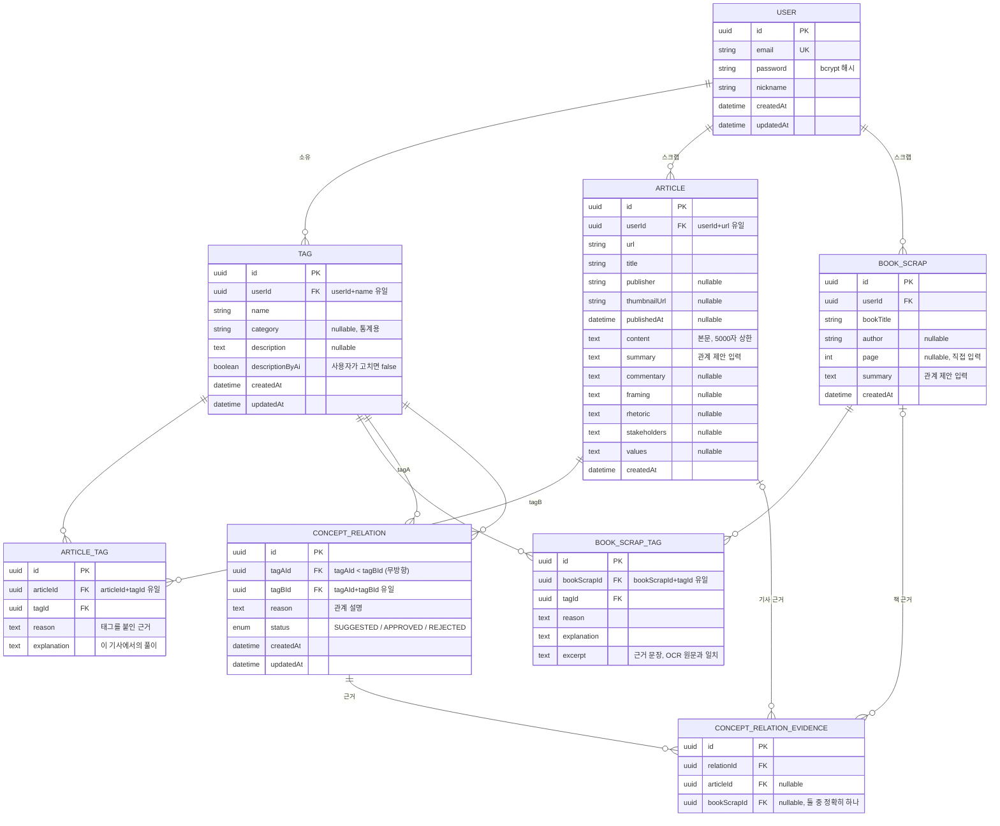

# Anomie ERD

10-28 기획 기준 8개 테이블. 실제 정의는 `server/prisma/schema.prisma`, 설계 배경은 `doc/plan.md` 3장.

## 스키마로 표현하지 못한 규칙

- **관계는 무방향**: `CONCEPT_RELATION`은 항상 `tagAId < tagBId`로 저장한다 (DB CHECK 제약). A—B / B—A 중복과 자기 자신과의 관계를 막는다.
- **근거는 하나만**: `CONCEPT_RELATION_EVIDENCE`는 `articleId` / `bookScrapId` 중 정확히 하나만 채운다 (DB CHECK 제약).
- **근거가 사라진 관계**: 스크랩을 지우면 근거 행은 자동으로 지워진다(Cascade). 근거가 0개가 된 관계는 서버가 같은 트랜잭션에서 지우되, `REJECTED` 관계는 같은 쌍 재제안을 막기 위해 남긴다.
- **보관하지 않는 것**: 책 사진과 OCR 추출 전문은 저장하지 않고, 근거 문장(`excerpt`)만 저장한다.
